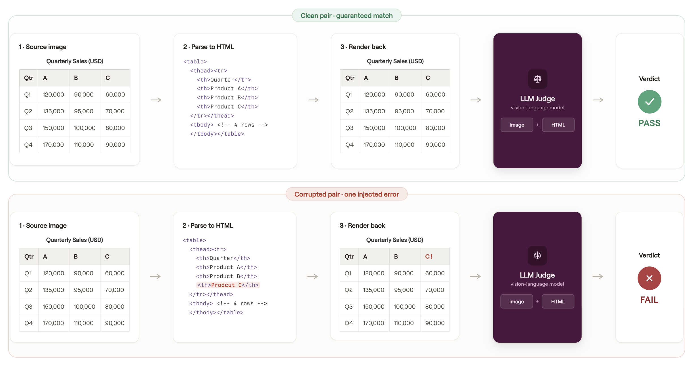
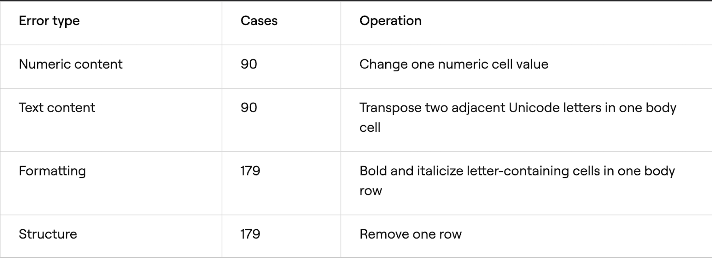
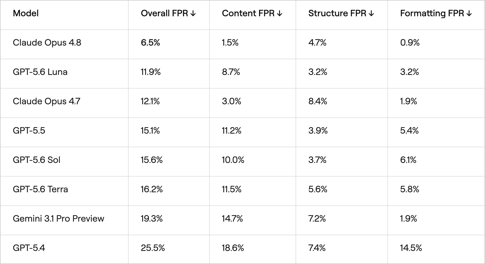
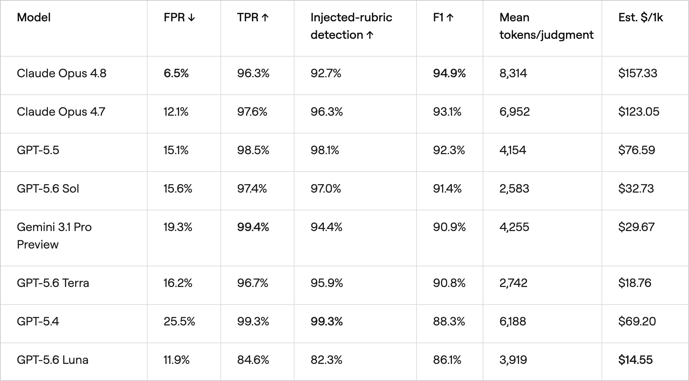
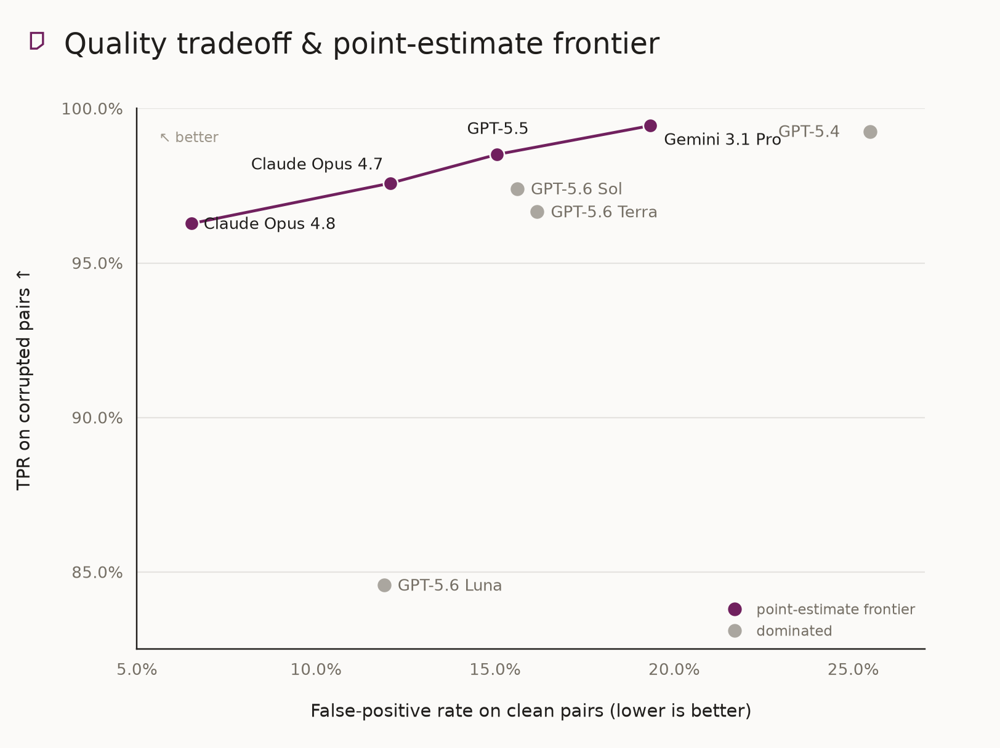
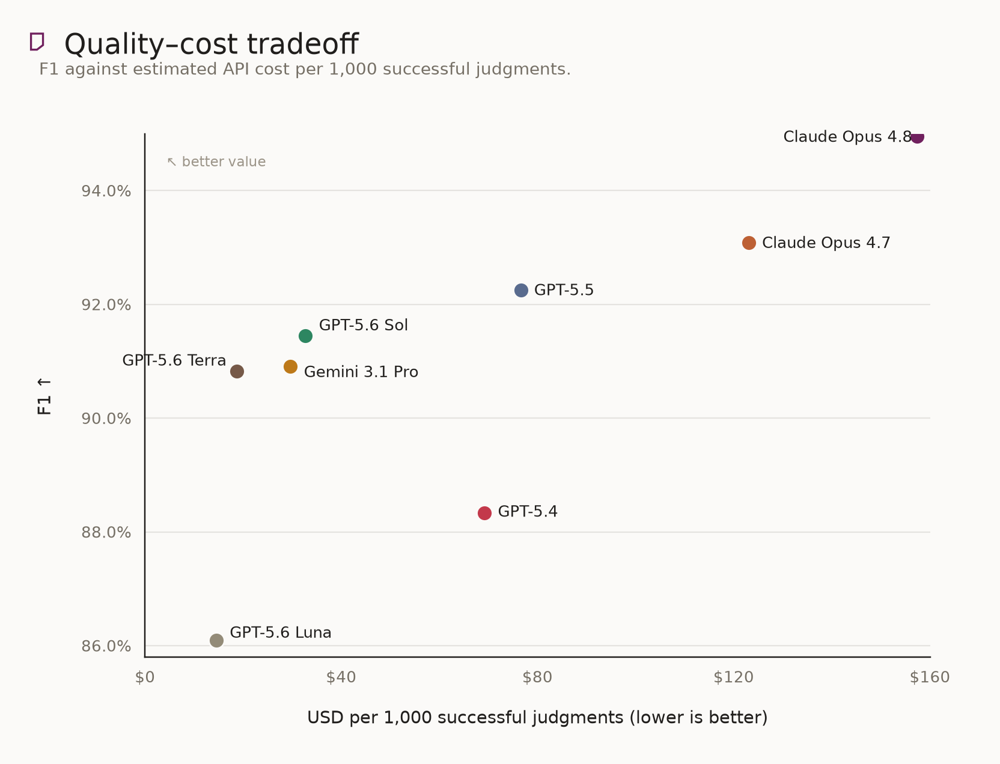
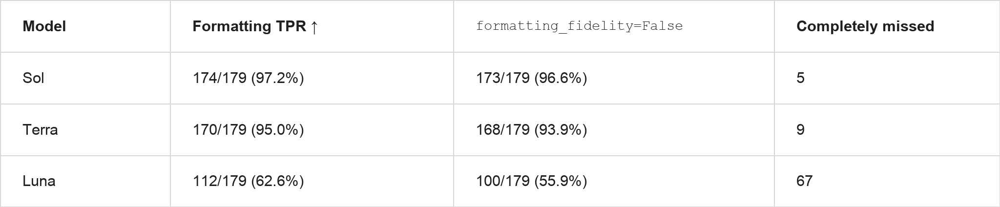
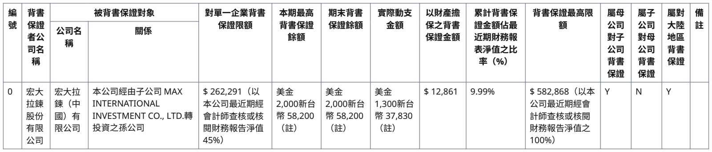

# The false positive problem: how LLM judges mislead table OCR benchmarks

We created a benchmark where the ground truth is known by construction, then used it to measure how often frontier LLM judges hallucinate table OCR errors.

A parsed table needs to be faithful across several dimensions: the right content in the right cells, correct rows, columns, spans, and headers, and meaningful formatting such as bold or italic emphasis. Human review does not scale, while rule-based metrics miss visual and structural nuance. Most teams therefore show an LLM judge the table image and candidate HTML and ask whether they match.

We wanted to test how reliable that measurement layer actually is. The key was building data where the correct verdict is not subjective.

We started with table HTML derived from [FinePDFs](https://huggingface.co/datasets/HuggingFaceFW/finepdfs) and rendered it back into images. Because each clean image is rendered directly from its HTML, every clean image–HTML pair is a guaranteed match. A judge that rejects a clean pair is wrong.

For every clean pair, we created one corrupted counterpart by changing a numeric value, transposing adjacent letters, adding bold italics to a body row, or removing a row. A good judge should accept the clean pair and catch the corrupted one.

*The benchmark pipeline: HTML is rendered to an image, then a judge evaluates the image–HTML pair and returns one verdict per rubric.*

The benchmark contains **538 clean pairs and 538 corrupted pairs**, tested across eight frontier models. Every response contains three decisions:

1. **Content accuracy:** correct values and labels, with no missing or extra data.
2. **Structural preservation:** correct rows, columns, spans, headers, and cell mappings.
3. **Formatting fidelity:** meaningful bold and italic emphasis and other visual conventions.

## Our findings

On the clean pairs—the ones that are guaranteed to match—every model invents errors.

Claude Opus 4.8 is the least trigger-happy judge, but it still rejects **35 of 537 clean pairs**, an FPR of **6.5%**. GPT-5.4 rejects **25.5%**. Even a strong judge can therefore make a real OCR system look worse than it is.

## The precision/recall tradeoff

False positives are only half the picture. We also measure whether a judge catches the controlled errors:

- **TPR:** the judge marks at least one rubric `False` on a corrupted pair.
- **Injected-rubric detection:** the judge marks the specific rubric targeted by the corruption `False`.

F1 treats corrupted HTML as the positive class and combines precision with TPR. TPR is the operational measure—did the quality gate stop the bad pair? Injected-rubric detection asks whether it diagnosed the intended error.

*Mean tokens per judgment is provider-reported input plus output, averaged over successful calls. It helps explain cost, but token prices and cache treatment also differ by model.*

Several patterns stand out:

- **GPT-5.6 Luna** is cheap and relatively conservative, but its **84.6% TPR** means it misses many injected errors.
- **Claude Opus 4.8** is the best choice when false alarms are expensive. It has the lowest FPR and the highest F1, at the highest estimated cost.
- **GPT-5.6 Sol** is a practical cost–quality tradeoff. It trails GPT-5.5 by 0.9 F1 points while costing an estimated **57% less** per 1,000 successful judgments.
- **GPT-5.6 Terra** is cheaper again, with similar aggregate F1 to Gemini but a different error profile.
- **Gemini 3.1 Pro Preview** has the highest observed TPR, **99.4%**, but also flags **19.3%** of clean pairs.

## Where judges fail

### Formatting separates the GPT-5.6 family

Content and structure errors are comparatively easy. Formatting produces the largest gap among Sol, Terra, and Luna.

Luna completely misses 67 of the 179 formatting corruptions. Sol catches 64 of those misses, Terra catches 62, and both catch 61 by specifically marking `formatting_fidelity=False`.

The source row below is regular and upright:

The corrupted HTML makes every letter-containing body cell bold and italic. Sol and Terra mark `formatting_fidelity=False`; Luna returns all three rubrics as `True` and describes the injected emphasis as faithful.

### Judges correct the source instead of comparing it

The source below really says `Pre-Primany / Primany`, and the clean HTML preserves that spelling:

Claude Opus 4.8, GPT-5.4, GPT-5.5, Sol, Terra, and Luna reject the matching clean HTML because they claim the image says `Pre-Primary / Primary`. Fluent correction is harmful here: the judge's job is fidelity, not copyediting.

## How this ties into an evaluation pipeline

These failure modes come from naive, single-call judgment: show one model the full image and full HTML, ask it to evaluate content, structure, and formatting at once, and treat the answer as ground truth. If the judge has a 6–25% clean-pair FPR, model comparisons built on that signal can be systematically skewed.

The answer is not to abandon LLM judges, but to use them deliberately:

- Report **FPR and TPR together**. A judge can appear conservative simply because it misses errors.
- Keep rubric decisions separate. A scalar score hides confident hallucinations and category-specific blind spots.
- Ground judgments with trusted references when possible.
- Prefer comparative evaluation—“which output is better?”—when an absolute correctness verdict is not necessary.
- Calibrate the judge on clean and deliberately corrupted examples from your own document distribution.

This benchmark evaluates the combined three-rubric prompt. It does not directly measure split-call, reference-grounded, or pairwise-judge mitigations; those should be validated separately before deployment.

The release includes the [benchmark data and construction notes](data/README.md), [raw response provenance and reproduction commands](results/README.md), and [full analysis tables and figure data](results/benchmark/analysis/README.md).

*Engineering by Jean Ghislain Billa, Yifei Hu, and the Reducto ML team. Written by Palak Agarwal.*

If these problems excite you, visit the [Reducto careers page](https://reducto.ai/careers) and the [engineering blog](https://eng.reducto.ai/).
